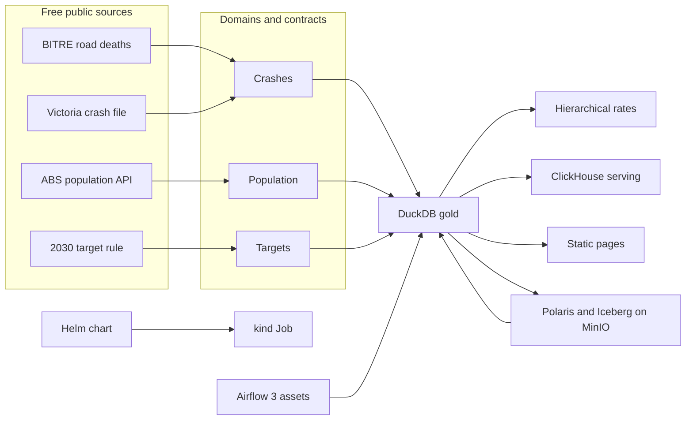

# Road toll reversal

Australia is in a sixth straight year of rising road deaths. In the 12 months to September 2026, **1,334 people died**. The straight path to the national goal — half the 2018–2020 toll by the end of 2030 — allowed about **812**. That is **522 more deaths** than the path. January to September 2026 is already **1,001** deaths, above the full-year ceiling for 2026 (**798**) and the highest January–September toll since 2009.

This project tells state road-safety agencies where holiday-season (December–January) enforcement and infrastructure money should go: which states, communities, road users, ages, hours and roads carry that gap. The public pages are at [luciferdataengineer.github.io/road-toll-reversal](https://luciferdataengineer.github.io/road-toll-reversal/). They update when this repository’s main branch is published.

[](https://github.com/LuciferDataEngineer/road-toll-reversal/actions/workflows/ci.yml)
[](https://luciferdataengineer.github.io/road-toll-reversal/)

The numbers below are computed from the committed snapshot, not typed in by hand. `INSIGHTS.md` is the stakeholder note. This file is the engineering note.

## The decision

Put the summer effort in four places at once:

1. **Queensland, then New South Wales, Victoria and Western Australia.** Their gaps against their own paths are 138, 122, 105 and 88 deaths. Those four states are most of the national gap of 522.
2. **Regional communities that sit above the rest of their state**, after allowing for small numbers. The clearest are Western Australia’s Wheat Belt, Queensland’s Wide Bay and Darling Downs, Victoria’s Hume corridor, and New South Wales’ New England, Central West and Capital region. The Northern Territory is a different problem: the highest risk per person, **13.0 deaths per 100,000**, against **4.8** nationally, even though the gap in lives is small.
3. **People outside cars, without ignoring drivers.** Drivers are still the largest gap (201 deaths above their path). Motorcyclists are 124 above theirs, pedestrians 85, cyclists 26. Cyclist deaths (54) are about double the path set from 2018–2020.
4. **Afternoons and faster roads.** The worst hour in the last year is 4pm (93 deaths). In Victoria, about 9 in 100 fatal-or-serious crashes on roads of 90 km/h and above were fatal, against about 2 in 100 on streets up to 50 km/h. Most Victorian fatal crashes were not at an intersection.

Two states need a specific call. South Australia’s January–September toll (**84**) has already passed the full-year 2026 ceiling (**67**). Western Australia’s latest 12 months (**201**) are its worst September-ending year since 2010.

December and January are **not** deadlier per day than the rest of the year (3.42 deaths a day against 3.45 over 2022–2025). Last summer was still 216 deaths against a summer path of 143. The holiday blitz should be aimed at the year-round gaps, not designed as if only holiday weekends kill.

## What’s new vs project 12 (home-battery-payback)

Project 12 was a lakehouse on PyFlink SQL, an Iceberg REST catalog with MinIO and Trino, DuckDB, Dagster asset checks, OpenLineage, Pandera and a Kubernetes Job. This project keeps DuckDB as the fast default and steps up in six places:

| | Project 12 | This project |
| --- | --- | --- |
| Ownership | One pipeline | Three data-mesh domains (crashes, population, targets), each with an Open Data Contract Standard file enforced by `datacontract` |
| Catalog | Iceberg REST, one warehouse | Apache Polaris REST catalog, MinIO, and a principal per domain so the crashes owner is refused the population namespace |
| Orchestration | Dagster | Apache Airflow 3 TaskFlow DAGs. The targets DAG is scheduled on the crashes and population assets |
| Uncertainty | Point estimates | A PyMC hierarchical model: communities pool toward their state, road-user groups pool nationally, with a posterior predictive check |
| Serving | Trino | ClickHouse next to DuckDB, with a repeated-query benchmark and a cost note |
| Deploy | A kind Job | A Helm chart that runs that Job on kind in CI |

Earlier portfolio pieces already used Kafka, Debezium, Spark, Delta, Feast, MLflow, Evidently, LightGBM, MetricFlow, Great Expectations, pgvector, Airflow and Terraform. They are not repeated here.

## Architecture



`make all` never starts Docker. It reads `data/snapshot`, builds the DuckDB warehouse, fits the rate model, and writes `site/`. Docker is only for Polaris, ClickHouse, Airflow and the kind job. Those run as separate CI jobs so a registry hiccup does not take down the core check.

## Stack, and why

| Piece | Why it is here |
| --- | --- |
| DuckDB | Default warehouse. One file, SQL the contracts can test, fast on 60,000 death rows. No server to keep up. |
| Open Data Contract Standard + datacontract | Each domain publishes the shape and the checks it will stand behind, including “1,334 deaths in the 12 months to September 2026”. CI fails if the gold tables drift. |
| PyMC | Small communities have noisy death counts. Partial pooling stops a single bad year from looking like a hotspot, and the predictive check shows the model still matches the total toll. |
| Apache Polaris + Iceberg + MinIO-compatible storage | The gold gap table is a real Iceberg table. Domain principals are separate. DuckDB reads it back. Official MinIO images no longer allow anonymous pulls, so Compose uses `pgsty/silo`, a free MinIO-compatible fork with the same S3 API. |
| Airflow 3 assets | The targets product is not on a clock. It runs when the crashes and population assets update. |
| ClickHouse | A serving engine for the same questions, benchmarked against DuckDB. At this size DuckDB is the right default; the write-up says so with timings. |
| Helm + kind | The fast pipeline is a charted Kubernetes Job, not a hand-applied manifest. |
| Static pages | Stakeholders get a dark, tabbed briefing on GitHub Pages. No application server. |

Postgres is not used. Polaris in this compose uses its bootstrap file store rather than a hosted database. Airflow’s metadata database stays inside the CI container. Nothing is Supabase, Snowflake, BigQuery, Databricks or a paid API.

## Data

Every file under `data/snapshot` is an extract of a free, openly licensed source. `data/manifest.json` records the URL, licence, access date (11 November 2026), sha256 and row count. Refresh with `python scripts/refresh_snapshot.py` when BITRE publishes the next month. The default pipeline does not download.

| Dataset | Publisher | Licence | Coverage | Rows in the snapshot |
| --- | --- | --- | --- | --- |
| [Australian Road Deaths Database](https://catalogue.data.infrastructure.gov.au/dataset/australian-road-deaths-database), `bitre_fatalities_sep2026.xlsx` | BITRE | CC BY 3.0 Australia | Person-level deaths, 1989 to September 2026 | 59,169 |
| [ERP_Q on the ABS Data API](https://data.api.abs.gov.au/rest/data/ERP_Q/all?startPeriod=2017-Q4&endPeriod=2026-Q3&format=csv) | Australian Bureau of Statistics | CC BY 4.0 | State population by sex and single year of age, 2017 Q4 to 2026 Q1. No API key | 31,824 |
| [ABS_ANNUAL_ERP_ASGS2021, SA4](https://data.api.abs.gov.au/rest/data/ABS_ANNUAL_ERP_ASGS2021/ERP.SA4..A?startPeriod=2018&endPeriod=2025) | Australian Bureau of Statistics | CC BY 4.0 | Population of 89 statistical areas, 30 June 2018 to 30 June 2025 | 712 |
| [Victorian Road Crash Data](https://discover.data.vic.gov.au/dataset/victoria-road-crash-data) | Department of Transport and Planning, Victoria | CC BY 4.0 | Fatal and serious-injury crashes from 2018. The source file runs to 28 March 2026; 2026 is partial, so environment comparisons stop at 2025 | 43,005 |
| [Natural Earth 1:50m admin-1](https://www.naturalearthdata.com/) | Natural Earth | Public domain | Eight state and territory outlines. The ABS boundary service returned an error on the access date, so the map uses these outlines only. The statistics do not come from the map | 8 |
| [NRSS performance-monitoring fact sheet](https://www.roadsafety.gov.au/nrss/fact-sheets/performance-monitoring) | Office of Road Safety | Government policy parameters, attributed | The rule only: 50% fewer deaths by 2030 against the 2018–2020 average, and a 55% lower per-person rate. Death counts are computed here, not copied | 7 parameters |

BITRE stopped publishing a separate fatal-crashes file in May 2025. Crash attributes now sit on each fatality row. A fatal crash is a distinct crash id. Recent months are preliminary.

The ABS extract’s age code `8599` is an “85 and over” duplicate of the single years. It is dropped. After that, single years sum to the published all-ages total exactly (Australia at 30 September 2025 in this extract: 27,712,106; at 31 March 2026: 27,921,150).

## Cleaning and the path

Deaths with a missing age (`-9` in the source) become null and drop out of age rates only. Unknown road user, speed, remoteness and road type are kept in the totals and left off the ranked charts. Motorcycle riders and pillion passengers are one group. Hours come from the recorded time; one recent death has no hour.

The 2030 path follows the rule agencies already use to score the strategy. The baseline is the average of calendar years 2018, 2019 and 2020. At the end of 2020 the path is that baseline. At the end of 2030 it is half. Months in between are linear. For the 12 months ending September 2026 that factor is `1 - 0.5 × 69/120 = 0.7125`. The national baseline in this extract is **1,139.3** deaths a year, so the path is **811.8**, shown as **812** so the page arithmetic is in whole people (1,334 − 812 = 522). An earlier AAA benchmark quoted a baseline of 1,142 from a previous BITRE revision. This snapshot is the September 2026 file, and the baseline moves when history is revised.

The Strategy sets a national target, not state targets. State paths apply the same halving rule to each state’s own 2018–2020 average, which is how jurisdictional progress is read in the AAA benchmark. That choice is labelled on the contracts and on the pages.

Rates per 100,000 use the ABS population at 31 March 2026, the newest quarter in the API extract. They are not per kilometre driven and not per licensed rider. A high motorcyclist rate can mean more riding, more risk per ride, or both. The pages do not pretend to separate those.

## Data model

DuckDB file `data/gold/road_toll.duckdb` (built, not committed):

| Table | Grain | Domain |
| --- | --- | --- |
| `fatalities` | One person killed | crashes |
| `vic_crashes` | One Victorian fatal or serious crash | crashes |
| `erp_state_age` | State, quarter, age band | population |
| `erp_sex` | State, quarter, sex | population |
| `sa4_population` | Statistical area, year | population |
| `state_month_path` | State and Australia, each month 2018–2030, with the rolling toll and the path | targets |
| `slice_latest` | State × road user, age, hour-of-day group, weekday, speed, remoteness, road type, summer | serving |
| `sa4_group_year` | Community × road user × year, 2022–2025, with zeros filled in | serving |
| `group_target_rate` | State × road user, baseline rate and the 2022–2025 average path | targets |
| `sa4_risk` | Community × road user, likely range for the annual rate | model |

Contracts in `contracts/` check the crashes, population and targets tables, including the locked toll of 1,334, the population of 27,921,150 at March 2026, and the path factors 1.0 at December 2020 and 0.5 at December 2030.

## The rate model

For each statistical area, road-user group and year from 2022 to 2025:

`deaths ~ Poisson(population / 100,000 × rate)`

`log(rate)` is a national level, plus a state shift, plus a community shift pulled toward that state, plus a road-user shift. Four chains, 500 tune and 500 draw iterations, seed 20261111. A place is called out only when at least five people in that group died over the four years and the 10th–90th percentile of its rate sits entirely above the state rate.

The predictive check reproduces the observed total (4,916 deaths in those cells; the predictive mean matches it, and the central 90% band contains it) and a similar share of community-years with no deaths. There were no divergent samples. The state-spread parameter’s r-hat is about 1.04, which is a bit high; the places listed on the page are unanimous across samples (the chance they sit above their state is effectively 1). Re-run with `make model`. The summary is `data/model/ppc.json`.

## How to run

```bash
python -m venv .venv
source .venv/bin/activate
pip install -r requirements.txt
make all          # DuckDB gold, rate model, site/
make test         # ruff and pytest
make contracts    # datacontract test on the three domains
```

PyMC compiles a small extension, so a C++ compiler and Python headers are required (`g++` and `python3-dev` on Debian).

Optional stacks, each free and local:

```bash
docker compose up -d clickhouse
make bench

docker compose up -d minio bucket polaris
pip install -r requirements-iceberg.txt
make pipeline && make iceberg

# Airflow 3, from the official image, with this repo mounted at /work
# see .github/workflows/ci.yml

docker build -t road-toll-pipeline:local .
kind create cluster --name road-toll
kind load docker-image road-toll-pipeline:local --name road-toll
helm upgrade --install road-toll helm/road-toll-job --set image.pullPolicy=Never
kubectl logs job/road-toll-pipeline
```

Open `site/index.html` after `make all`. The Pages workflow rebuilds the site on every push to `main`.

## Benchmark and cost

Both engines are open source. The benchmark copies the gold death rows and the community table into a local ClickHouse container and runs four aggregations 25 times after a warmup, then runs the state total eight times at once. Results land in `data/benchmark/results.json` when you run `make bench`. CI uploads that file.

At about 59,000 death rows, DuckDB answers these aggregations in a few milliseconds inside the same process. ClickHouse pays a network round trip to the server on every call, so a single analyst query is slower even though the engine itself is built for large scans and many concurrent readers. Eight queries at once is the case where a serving engine starts to earn its keep, and even then this table is small. There is no cloud bill either way: no Snowflake credits, no warehouse hours. The default path stays on DuckDB. ClickHouse is here for the day the crash-level history is tens of millions of rows and many people open the same briefing at once. The Victoria source file, before the fatal-and-serious cut, is about 200,000 crashes — still DuckDB territory.

## Testing and CI

`pytest` locks the published toll (1,334), the path arithmetic, South Australia’s broken ceiling, the six-year rise, the summer daily rate, the model’s predictive check, and a ban on tool names in the public pages. `datacontract test` checks the three domain contracts against the DuckDB file.

GitHub Actions:

- **core** — `make all`, contracts, ruff, pytest
- **clickhouse** — the benchmark, as an artifact
- **polaris** — MinIO, Polaris 1.8, domain principals, Iceberg write, DuckDB read of the September gap (Australia must come back as 1,334)
- **airflow** — Airflow 3.4 parses the DAGs, checks that targets is scheduled on the crashes and population assets, and runs each domain
- **kind** — Helm installs the pipeline Job and the logs must contain 1,334
- **pages** — rebuilds the site on `main` and deploys it

## Pages

Five tabs, not one long scroll: the toll, where, who, when, and the summer plan. Each has a headline, big numbers with a plain status, one main picture (the path, or the map), and at most three supporting charts. Filters are the states. Charts are inline SVG with a viewBox, drawn after the tab is shown, so a hidden tab cannot collapse the axes. Labels sit in a fixed gutter or on the peak only. The map is the Natural Earth file in the repository. There is no tile server. Times are Australian eastern time: the toll is current to 30 September 2026 AEST, and the page stamp uses Sydney local time.

## Limitations and next steps

- No exposure in kilometres, registered vehicles, or enforcement hours. Rates are per person.
- BITRE will revise 2026. The snapshot is one access date.
- About 100 of the latest deaths have no remoteness code.
- Community population ends at June 2025. The model uses that year’s population for 2025 and the matching June for earlier years.
- The state paths are a reading of the national rule, not targets the Strategy itself sets.
- Victoria’s open file is not the BITRE death count and is not complete for 2026.
- The hierarchical model’s state-spread parameter is not as settled as the community rankings. More draws would tighten it; the listed places already clear their state by a wide margin.
- Polaris here is a single-node compose with bootstrap credentials. That is a catalog for the lab, not a production realm. The object store is Silo (`pgsty/silo`), a free MinIO-compatible fork, because the official MinIO images no longer allow anonymous pulls.

Next: a serious-injury path once a national serious-injury file is as open as the deaths file, and vehicle-kilometres if a free state series can be joined without a private key.

## Licence

Code in this repository is MIT, see `LICENSE`. The data keeps the licences in the table above. Do not treat the snapshot as MIT.
